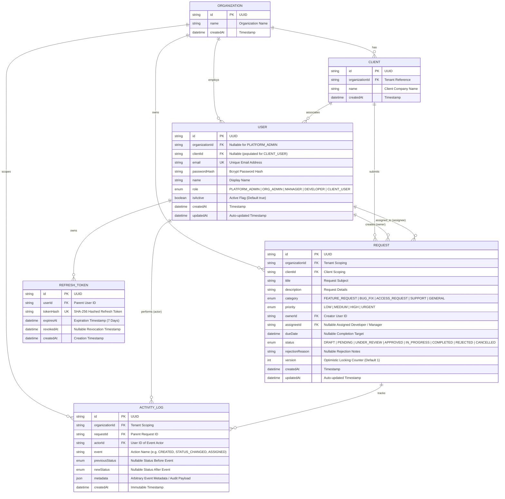

# Entity-Relationship Diagram (ERD)

This document describes the relational database schema for the **Multi-Tenant Client Request & Approval Workflow Engine** implemented via PostgreSQL and Prisma ORM.

## Visual ERD

---

## Model Descriptions & Key Decisions

### 1. `Organization` (Tenant Root)
- Serves as the top-level isolation boundary for each tenant.
- All requests, clients, internal users, and audit logs are scoped under an `organizationId`.

### 2. `Client` (B2B Customer of the Organization)
- Represents an external business client who submits requests into the tenant's workflow engine.
- Has a 1-to-many relationship with `User` (specifically `CLIENT_USER` accounts) and `Request`.

### 3. `User` (Identity & RBAC)
- **Multi-tenant Identity**:
  - `PLATFORM_ADMIN`: `organizationId = null` (global administrative oversight).
  - Internal Staff (`ORG_ADMIN`, `MANAGER`, `DEVELOPER`): `organizationId != null`, `clientId = null`.
  - External Customers (`CLIENT_USER`): `organizationId != null` AND `clientId != null`.
- **Security**:
  - `passwordHash`: Stored as a salted bcrypt hash.
  - `isActive`: Boolean flag to instantly cut off access upon user termination without breaking relational audit integrity.

### 4. `Request` (Core Workflow Entity)
- **Multi-Tenant Performance & Security Indexes**:
  - `organizationId`: Fast tenant filtering.
  - `(organizationId, status)`: Compound index for filtering active workflows by state.
  - `(organizationId, clientId)`: Compound index for client portal views.
  - `assigneeId`: Index for staff dashboard work queues.
  - `dueDate`: Index for SLA monitoring and calendar sorting.
- **Optimistic Concurrency**:
  - `version Int @default(1)` protects against concurrent approval conflicts.

### 5. `ActivityLog` (Immutable Audit Trail)
- Tracks every mutation (status changes, reassignments, comments).
- Stores previous and new statuses, actor ID, and JSON metadata.
- Scoped by `organizationId` to guarantee tenant isolation during audit reporting.

### 6. `RefreshToken` (Secure Session Lifecycle)
- Stores SHA-256 hashed refresh tokens (`tokenHash`) to prevent plaintext token leaks if the database is inspected.
- Supports **Refresh Token Rotation**: every refresh operation revokes the previous token (`revokedAt = now()`) and issues a new pair.

---

## Relational Hardening & Data Integrity

1. **Explicit `onDelete: Restrict` Protection**:
   - `Request`, `ActivityLog`, `User`, and `Client` relationships use `onDelete: Restrict` rather than `Cascade`.
   - This ensures historical request and audit records cannot be inadvertently deleted or destroyed by cascading foreign key drops.

2. **Cross-Tenant Client Isolation via Composite Foreign Key**:
   - `Client` declares a unique composite key on `(id, organizationId)`.
   - `Request` references `(clientId, organizationId)` via composite foreign key `FOREIGN KEY ("clientId", "organizationId") REFERENCES "clients"("id", "organizationId") ON DELETE RESTRICT`.
   - This database-level constraint physically guarantees that a `Request` can never reference a `Client` belonging to a different `Organization`.

3. **User Organization Check Constraint**:
   - Database CHECK constraint `chk_user_organization` enforces `("role" = 'PLATFORM_ADMIN' OR "organizationId" IS NOT NULL)`.
   - Non-platform administrators can never exist in the database without an assigned tenant organization.

